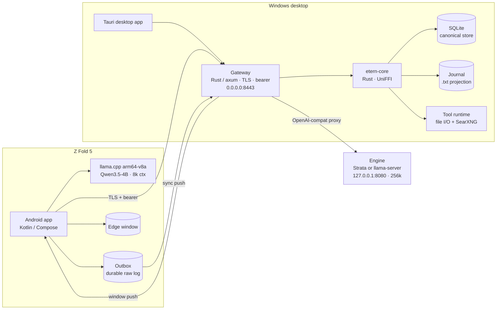

# EternAI — Persistent Dual-Model AI Companion

**Target host:** Windows 11 Pro · 2× Tesla P100-PCIE 16GB (sm_60) · 274 GB RAM
**Target edge:** Samsung Galaxy Z Fold 5 (Snapdragon 8 Gen 2, 12 GB RAM, 512 GB)
**Status:** plan finalised, build starting at M0.

---

## 0. Verified facts about your existing stack

Everything below was read off your machine, not assumed.

| Fact | Value | Consequence |
|---|---|---|
| High-power endpoint | `http://127.0.0.1:8080`, engine `strata` v0.1.57 | Harness must be engine-agnostic, not llama.cpp-specific |
| Model served now | `qwen3.8-flash-next-unsloth-ud-q4_k_xl` (4 shards, ~104 GB) | — |
| Context | `--max-context 262144` (256k), `--kv int8`, `--kv-resident 32768` | **Your 200k requirement is already met.** No re-litigating. |
| Extras | `--spec 4`, `--mtp`, expert-cache, `--vision` (mmproj BF16, CPU/16 thr) | Vision input works server-side today |
| Warm-up | `engine_ready_s: 1230` (~20 min) | Health router needs `loading` ≠ `down` |
| Auth | `/health` → `"api_key": false` | **No auth today.** Gateway must add it. |
| Your llama.cpp install | `C:\Users\phoenix\Documents\Release\llama-server.exe` | Second engine option |
| Your launch scripts | `Q38-27B.ps1`, `Q38-27B-Humanlike.ps1`, `Q35-9B-Q8.ps1`, `Q36-35B-A3B.ps1`, `Q38FN-Strata.ps1` + `ModelSwitcher.ps1` | **You hot-swap models.** Harness must re-detect on swap. |
| Bind address in your scripts | `--host 0.0.0.0 --port 8080` | LAN exposure is already your habit; the phone can reach it |
| Edge model | `Qwen3.5-4B-UD-Q4_K_XL.gguf` **2.79 GB** + `mmproj-F16.gguf` 0.63 GB, already in HF cache | Fits the phone with room to spare; **vision on-device too** |

### Tokenizer parity — verified by reading GGUF headers

| Key | Qwen3.8 Flash Next | Qwen3.5-4B | Match |
|---|---|---|---|
| `tokenizer.ggml.pre` | `qwen35` | `qwen35` | ✅ |
| `tokenizer.ggml.model` | `gpt2` (BPE) | `gpt2` (BPE) | ✅ |
| `eos_token_id` | `248046` | `248046` | ✅ |
| `add_bos_token` | `false` | `false` | ✅ |

**Same tokenizer.** A given string costs the same number of tokens on both devices. This is what makes "latest 6k tokens" a well-defined, device-independent quantity.

### Chat templates — verified to DIFFER

| | chars | sha256 |
|---|---|---|
| big | 9993 | `12827f24b742` |
| small | 7992 | `8452ca85cb1e` |

Differences that matter:

1. The big template **injects a `reasoning_instructions` block into the system message** (`xhigh`/`medium`/`low` effort). The small one has no such feature.
2. The big template `raise_exception`s on a system message that isn't first. The small one silently merges up to two leading system messages.
3. The big template honours `preserve_thinking`; the small one strips `<think>` from history unconditionally.

**Design consequence (§4):** the desktop cannot be the sole authority on the edge window's token count. It *proposes*; the phone, which owns the real edge template, *disposes*.

---

## 1. Architecture

**The phone never talks to the engine directly.** It only ever knows the gateway. That gives us one place for auth, TLS, health translation, sync, and model-swap detection — and it means your `ModelSwitcher.ps1` habit is safe.

### Why a gateway instead of pointing the phone at `:8080`

Your scripts already bind `0.0.0.0:8080`, so the phone *could* connect directly. But then: no auth (`api_key: false`), no TLS, no sync endpoints, no health translation across a 20-minute warm-up, and a model swap silently changes the chat template under the phone's feet. The gateway is ~400 lines of Rust and removes all five problems.

---

## 2. Routing model

Two independent signals, deliberately not collapsed into one "online/offline" boolean:

| `gateway_reachable` | `engine_ready` | Serve with | Sync |
|---|---|---|---|
| ✅ | ✅ | **high-power** | flush immediately |
| ✅ | ⏳ loading | **edge** | flush as soon as ready |
| ✅ | ❌ down | **edge** | flush on recovery |
| ❌ | — | **edge** | hold in outbox |

A model swap or a 20-minute load must **not** look like "lost the network" — otherwise the phone starts a second conversation history for no reason.

- `gateway_reachable`: 1.5 s TLS handshake + `GET /health`, 3 consecutive failures → false, exponential backoff 2 s → 30 s.
- `engine_ready`: gateway reports `loading` / `ready` / `busy` / `down`, derived from the engine's `/health` (`{"status":"ok","loaded":true,...}`) plus an in-flight request count.
- Every reply is labelled with the serving model (`Qwen3.8-Flash-Next` / `Qwen3.5-4B`) — you asked for this.

---

## 3. Context tiers

Both devices use the same tiering; only the budget differs.

| Tier | Content | Desktop | Edge |
|---|---|---|---|
| T0 | Persona, pinned, byte-stable | ~800 | ~600 |
| T1 | `MEMORY.md` distilled facts | ~1.5k | ~1k |
| T2 | Journal digest (rolling ~7 days) | ~4k | ~1.5k |
| T3 | Raw recent turns | remainder | ~4.4k |
| T4 | FTS5 retrieval on demand | tool call | tool call |
| — | reserved for output | 8k | 700 |
| **total** | | **256k** | **8k** |

T0–T2 form a **byte-stable prefix** so the engine's prompt cache actually hits. Anything that churns goes after it, never before.

Your spec said "latest 6k tokens". Within an 8k window that has to mean ~6k *of the 8k total*, not 6k of conversation on top of everything else — otherwise it overflows. Budget above reflects that.

---

## 4. The sync protocol (M6 — the risky part)

### 4a. Edge → desktop (offline catch-up)

1. Phone appends every prompt+response to a **durable, non-lossy, append-only outbox** (rotate at ~500 MB). Written *before* the UI shows the reply — a crash must not lose a turn.
2. On `gateway_reachable`, push in `(device_id, seq)` order.
3. Desktop dedupes on a unique index over `(device_id, turn_id)` — turn IDs are UUIDv7 minted on the phone. Replays are free.
4. Desktop writes the whole batch into the canonical store, then produces a `sync-<timestamp>.txt` Journal entry summarising it, with date/time.
5. All of it is appended to the high-power context.

**The phone never summarises.** A 4B writing a summary of a 4B conversation produces confident garbage, and it happens at the worst possible moment (offline, small model, already loaded). Summarisation is exclusively a desktop job.

### 4b. Desktop → edge (the 6k window)

**KV cache can never be synced** — different architectures, different tensor layouts, different quantisations. Sync is *textual replay*: the desktop sends a turn list, the phone re-renders it through its own chat template.

**Desktop proposes:**
- Walk the canonical store backwards, newest first, cutting only on **turn boundaries** (never mid-turn, never orphaning a `tool` result from its `assistant` `tool_calls` — the big template will raise on that).
- Target **5.6k tokens, hard cap 6k**.
- Attach `window_seq` (monotonic watermark) + `template_sha`.

> **The engine is llama.cpp `llama-server`, which *does* have `POST /tokenize`.** The gateway probes the route on every discovery pass. When it answers, `/tokenize` is **proxied** through and `token_source: "engine"`. When it does not (e.g. a *Strata* service hot-swapped onto the same port 404s `/tokenize`), the gateway answers **501 + `token_source: "estimated"`** rather than proxying a guaranteed 404. The capability is auto-detected, so the gateway survives either engine.
>
> **Counting strategy (locked):**
> - The desktop-side count is **always an estimate of the edge window**, even when the engine tokenizes exactly: it is measured against the *desktop* chat template, whereas the phone re-renders with the *edge* template. The gateway therefore applies a **0.90 safety margin to the budget** (not to the measured cost) for *every* proposal, regardless of `token_source`, so an under-estimate eats headroom rather than overflowing the edge window. `/health` publishes this as `safety_margin`.
> - `token_source` is reported for diagnostics only — it tells the phone how trustworthy the desktop number is, but does not change the budget.
> - **The phone's own tokenizer is the sole authority** for the final trim — the desktop number is only ever a hint.
> - `/slots.n_prompt_tokens` is the only server-side token figure and the anchor for later calibration of the estimate.

**Phone disposes:**
- Re-render with the **edge** template, tokenize with the **edge** tokenizer (already loaded — free).
- If over `8192 − 700`, drop oldest turns until it fits.
- **Replace the window wholesale.** Never merge. Merging two windows is how you get duplicated turns.

This split is exactly what §0's template divergence forces: the desktop's number is a hint, the phone is authoritative. It also survives you swapping the desktop model in `ModelSwitcher`.

### 4c. Model-swap detection

Gateway caches `/props` (`model_alias`, `chat_template`). On every proxy call it compares `model_alias`; on change it re-reads the template, re-hashes it, and invalidates the prompt-cache prefix assumption. The phone learns the new `template_sha` on the next window push and re-renders.

---

## 5. Journal

- **Canonical form:** SQLite rows (`ts`, `kind`, `source`, `model`, `tokens`, `body`, `turn_refs`).
- **Projection:** `.txt` files rendered from those rows. Rebuildable at any time; deleting `Journal/` loses nothing.
- **Naming:** `2026-11-18.txt` (daily), `sync-2026-11-18T2114.txt` (offline catch-up). Two types, so they can never collide.
- **Day boundary: 04:00 local.** A 1 a.m. conversation belongs to the previous day.
- **Skip-empty guard:** zero turns in the window → no file, no entry.
- **Trigger:** scheduled end-of-day run **plus a catch-up sweep on desktop launch** — because the desktop is often asleep at 4 a.m.
- **Index:** FTS5 sidecar, rebuildable, not the source of truth.

---

## 6. Tools (both models, same contract)

| Tool | Notes |
|---|---|
| `read_file`, `write_file`, `list_dir` | **Path-allowlist sandbox.** Desktop: `Journal/`, `memory/`, `inbox/`. Phone: app-scoped storage only. Reject `..`, symlinks, UNC, drive escapes. |
| `web_search` | SearXNG instance. **Must return an explicit `no_network` result** rather than letting the model improvise an answer. |
| `remember` | Append a durable fact to `MEMORY.md` (T1). |

4B tool-calling is flaky, so: validate every call against JSON Schema, and on parse failure **auto-retry once with the error fed back**. Give the edge model a **reduced** tool set — fewer schemas, more compliance, and it saves the ~400 tokens of schema overhead.

---

## 7. Shared core

**Rust + UniFFI**, one crate, two consumers (Tauri commands, Kotlin bindings). One implementation of: canonical store, tier assembly, turn-boundary trimmer, journal renderer, sync protocol, tool contract.

The alternative — reimplementing the sync protocol twice in Rust and Kotlin — is where dual implementations quietly diverge, and a divergent sync is data loss on the phone.

---

## 8. Security

LAN-only, but your scripts already bind `0.0.0.0` with `api_key: false`, so "LAN-only" is not automatically safe.

1. Gateway listens `0.0.0.0:8443`, **TLS only** (self-signed CA generated on first run).
2. **QR pairing:** desktop shows a QR containing `{host, port, ca_pin, one_time_pair_code}`. Phone scans once, gets a long-lived bearer token bound to a device identity.
3. Desktop keeps a device registry; one-click revoke.
4. Windows firewall inbound rule for 8443, **Private profiles only** (all three profiles are currently Enabled).
5. Engine stays on `127.0.0.1` — the gateway is the only door.

---

## 9. Feature decisions

| Feature | Approach |
|---|---|
| **Vision** | Desktop: reuse the engine's existing mmproj (`images: true` today). Phone: `mmproj-F16.gguf` (0.63 GB) is already downloaded — on-device vision is nearly free. |
| **Voice** | Edge: Android `SpeechRecognizer` (on-device, zero latency, no VRAM) + `TextToSpeech`. Desktop: Whisper through the gateway. *Flagged for confirmation.* |
| **Response labelling** | Every reply carries `{model, engine, served_by, tokens}`; rendered as a chip in both UIs. |

---

## 10. Roadmap

| Phase | Deliverable | Verify by |
|---|---|---|
| **M0** | Install Rust + Android SDK; scaffold workspace; `etern-core` crate; SQLite schema | `cargo test` green |
| **M1** ✅ | Gateway: engine discovery, `/props` caching, `/v1/chat/completions` proxy, health state machine, `/etern/edge-window` propose, cold-boot grace | curl through gateway to live engine — **done: 85 tests green, clippy clean, verified live** |
| **M2** ✅ | Canonical store + tier assembly + turn-boundary trimmer + budgeting (`/tokenize` proxied when the engine has it; 0.90 margin always applied, phone authoritative) | unit tests on synthetic transcripts — **done: `tier.rs` T0–T3 assembly with byte-stable prefix, 99 tests green, clippy clean** |
| **M3** ✅ | Journal: renderer, 4 a.m. boundary, skip-empty, launch catch-up sweep, FTS5 | fake a day, check files — **done: engine-backed summariser with extractive fallback, launch catch-up + 4 a.m. scheduler wired into the gateway, `GET /etern/search` over FTS5; 112 tests green, clippy clean, verified live (catch-up wrote a real day file, search returned highlighted hits)** |
| **M4** ✅ | Tool runtime: sandboxed file I/O, SearXNG, schema validation + 1 retry | adversarial path tests — **done: shared `tools.rs` (path-allowlist `Sandbox` rejecting `..`/absolute/drive/UNC/symlink escapes, JSON-Schema-subset `validate`, append-only stamped+capped `MemoryStore`, `WebSearcher` trait with explicit `no_network`); gateway `SearxngSearcher` + `GET /etern/tools` + `POST /etern/tools/execute` (batch, per-call retryable errors); 154 tests green (28 new core + 14 new gateway), clippy clean, verified live (write/read/remember/web_search/no_network round-tripped, `../../` escape refused, MEMORY.md written to disk). **Live SearXNG verified**: Docker Desktop installed, SearXNG container on `localhost:5678` (JSON `format` enabled in `settings.yml`); gateway started with `--searxng=http://127.0.0.1:5678` returned real `web_search` results (`ok`/`status: ok`)** |
| **M5** ✅ | Tauri desktop app: chat, model chip, journal browser, pairing QR, engine status | manual — **done: Tauri 2 shell in `apps/desktop` (Vite + vanilla TS frontend; Rust side is the gateway's HTTP client so the webview never touches the network — no CORS, token stays out of page JS). Commands: `gateway_health`/`gateway_props` (engine status + model chip, polled every 5 s), `journal_list`/`journal_read` (journal browser over the new gateway `GET /etern/journal[/{name}]` endpoints), `chat_send` (streams engine SSE, relays as `chat://delta|done|error` Tauri events keyed by a frontend-minted correlation id). Settings view stores gateway base URL + bearer token in localStorage; pairing QR shows an M6 placeholder (device registry lands with sync). 3 shell tests + 92 gateway tests green, clippy clean, `tsc && vite build` clean. Run: `npm install` then `npm run tauri dev` in `apps/desktop` (gateway must be running). **Journal gap closed:** the proxy stays byte-for-byte passthrough, so the desktop shell now reports each finished exchange to the new `POST /etern/turns` (idempotent on the chat request's UUIDv7, own `device_id="desktop"` seq space so phone outbox replays never collide, recorded as `TurnKind::Chat` so routine 1 journals it *and* the phone's 8k window can see it). A failed record is a non-fatal `chat://notice`, never a lost reply. Verified live without loading a model (engine pointed at a dead port so the extractive fallback runs): record → store → launch catch-up sweep wrote a real `Journal/<date>.txt`, `GET /etern/journal` listed it, and `GET /etern/sync/window` served the turn to a phone identity. **Agentic capability (§6) now on desktop too:** `apps/desktop/src-tauri/src/tool_loop.rs` runs the same ≤8-round loop as the phone's `ToolLoop.kt` against the gateway's `/etern/tools` + `/etern/tools/execute`, picking its encoding per turn — native `tools`/`delta.tool_calls` when `/health` says the loaded template supports tools, otherwise the shared `ETOOL` text protocol from `etern-core::text_tools` (results replayed as `user` messages, protocol line never streamed to the screen thanks to a `TextGate` that holds back a marker-length tail so a marker split across SSE chunks is still caught). One auto-retry for retryable failures, tool traffic included in the `/etern/turns` record so the phone's 8k window can replay it, and the whole exchange (not just the reply) is what gets journaled. 17 shell tests green (12 new), clippy clean, `tsc && vite build` clean; frontend renders each step as a quiet `.msg-tool` chip ("searched the web") via `chat://tool`. **Loop proven end to end:** `tests/tool_loop_e2e.rs` drives `tool_loop::run` over a real socket against a mock gateway (real SSE framing, scripted engine, no model) and covers the native round trip, the `ETOOL` fallback when the template can't carry tools, the 8-round budget abort, and plain chat degrading without tools — which caught a real bug: the exchange omitted the user prompt and the closing reply, so `recordable_turn` rejected *every* desktop turn and nothing was ever journaled. 282 workspace tests green** |
| **M6** ✅ | **Sync: outbox, push, window propose/dispose, chaos tests** | airplane-mode round trips — **done: `etern-core` sync layer (append-only flushed+rotating `Outbox`, `SyncTurn`/`SyncBatch` with UUIDv7 `turn_id` idempotency, `MAX_SYNC_BATCH` 2000); gateway `POST /etern/sync/push` (device-token auth, dedupe on `turn_id`, stores turns as `TurnKind::Sync` attributed to the device, engine-summarised digest written to the Journal with a deterministic extractive fallback) and `GET /etern/sync/window` (edge-window propose against the 8k budget with safety margin; sync-kind turns deliberately excluded from future windows since the phone already holds them); device registry in the store with pairing (`POST /etern/pairings` → one-time code, unauthenticated `POST /etern/pair`, `GET /etern/devices`, `POST /etern/devices/{id}/revoke`); self-signed TLS via `rcgen` (ring) served by `axum-server` on `--tls-listen` (default 8443, cert+key in `<store>/tls/`, SHA-256 DER pin published on `/health` as `cert_pin`, plus `lan_ip`/`tls_port` for the QR); desktop pairing UI (Settings → generate code, QR rendered as SVG from the `{host,port,cert_pin,code}` payload, device list with revoke). 199 workspace tests green (118 gateway + 77 core + 4 shell), clippy clean, `tsc && vite build` clean. Live smoke: HTTPS `/health` pin matched `cert.pem` SHA-256, pair→push→replay-dedupe→devices→revoke→401 round-tripped** |
| **M7** 🟡 | Android app: llama.cpp Vulkan, 8k window, offline chat, QR pairing, voice | manual + parity check — **in progress on-device.** APK builds and installs (`apps/android/app/build/outputs/apk/debug/app-debug.apk`, arm64-v8a, CPU-only: `-Vulkan` still blocked on missing SPIRV-Headers). **Launch crash fixed:** `ChatViewModel(app: Application)` extended plain `ViewModel`, but `MainActivity` resolves it through the default `AndroidViewModelFactory`, which only injects `Application` into `AndroidViewModel` subclasses and otherwise demands a no-arg constructor — so it threw `Cannot create an instance of ChatViewModel` inside `setContent`, killing the app before a frame was drawn. Now `AndroidViewModel(app)`. Also dropped `MainActivity`'s unconditional `startServices()` (an unpaired install probed forever; `EternApplication` and `PairingClient` already cover both real paths). Verified: `:app:assembleDebug` + `:app:testDebugUnitTest` green. A missing GGUF was never the cause — `LlamaEdgeEngine` mkdirs `files/models` at startup and only maps a model on the first offline prompt. **In-app GGUF import added:** the model directory is `/data/data/dev.eternai.app/files/models`, which no file manager can reach on Android 11+, so the old "copy with adb or a file manager" hint was a dead end for a sideloaded install. `LlamaEdgeEngine.importModel()` streams a picked document into a `.part` file and renames it only on success (an aborted multi-GB copy must not appear in the picker as a loadable model), refusing non-`.gguf` names and short filesystems; `ChatViewModel.importModel()` reports megabytes as they land and auto-selects the result; `ModelSheet` gained an "Import GGUF" button on `OpenDocument` with a `*/*` filter (managers report GGUFs as `application/octet-stream` at best) plus a progress bar. Re-verified green after the change. **QR scan silently did nothing — fixed:** `PairingSheet` read the scan result as `(result as? Intent)?.getStringExtra("SCAN_RESULT")`, but `ScanContract.parseResult` already converts the activity result into a `ScanIntentResult`, so that cast was always null, `text` was always blank, and the callback took the "user cancelled" branch — the camera closed and the pairing card reappeared unchanged, with no error. Now `result?.contents`. (The paste-the-payload path was unaffected, which is why it looked like the QR itself was broken.) **Paired successfully on-device** (QR + desktop "Test connection" both green). **Offline "No implementation found for ... nativeGenerate" fixed:** Gradle never compiles native code — `:app:assembleDebug` only packages the `.so` already sitting in `app/src/main/jniLibs`, and that library was built 26 seconds *before* `nativeGenerate` was added to `etern_engine.cpp`, so the APK shipped a lib exporting only 4 of the 5 `external fun`s (`llvm-readelf --dyn-syms` on the packaged `.so` proved it). Re-ran `native\build-android.ps1` (llama.cpp static libs were cached, so only the JNI wrapper recompiled) and confirmed all 5 symbols inside the new APK. `build-android.ps1` now parses the `external fun` list out of `LlamaNative.kt` and throws if any `Java_dev_eternai_app_engine_LlamaNative_*` symbol is absent — by name rather than the old "at least 5" count, so a rename can't slip past (negative-tested). **Offline replies took minutes — fixed (unverified on-device):** two independent causes. (1) `Qwen3.5-4B` is a reasoning model, so every prompt began with a long hidden chain of thought — "nothing for minutes, then slow text". `llama_chat_apply_template` takes no variables, so the template's own thinking switch can't be honoured; instead `suppress_reasoning()` closes the reasoning block in the rendered prompt (it `rfind`s the open token and either closes a block the template already opened or appends a complete empty one). Gated on the template containing `think`, so non-reasoning models are byte-identical to before, and exposed as a persistent **Model → "Think before answering"** switch (`Prefs.edgeThinking`, default off) because closing the block is a convention, not a guarantee; toggling it unloads the model since the flag is read at load time. (2) The app resends the whole chat every turn and `nativeGenerate` called `llama_memory_seq_rm(..., 0, 0, -1)` unconditionally, so the 8k context was re-prefilled from scratch each time. It now computes the common token prefix with the previous prompt, drops the KV past it, and prefills only the delta. Position-safe: `llama_batch_get_one` leaves `pos` null and `llama-batch.cpp` derives the next position from `llama_memory_seq_pos_max`, which `seq_rm` lowers (verified against the local llama.cpp tree, not assumed). `reuse` is clamped to `ntok - 1` so logits always exist, a failed/aborted prefill clears the record so a half-written prefix can't be reused, and the trim-to-fit path naturally yields zero reuse. `n_batch`/`n_ubatch` raised 512 → 1024 and `DEFAULT_EDGE_MAX_TOKENS` 512 → 1024 to match the Rust 700-token output reserve. **Keyboard covered the input box — fixed:** with `targetSdk 35` Android 15 forces edge-to-edge and no longer resizes the window for the IME, so `windowSoftInputMode="adjustResize"` alone does nothing; `ChatScreen` now reads `WindowInsets.ime` minus `navigationBars` and pads the content `Column` by the difference (the chat `LaunchedEffect` also keys on it so the newest bubble stays visible). Re-verified: `build-android.ps1` (5/5 JNI exports) + `:app:assembleDebug` + `:app:testDebugUnitTest` green. **Offline output was nonsense — two causes fixed (unverified on-device):** (1) the sampler chain contradicted the model's own published sampling guidance. It ran `top_k 40`, `top_p 0.95`, `temp_ext(temp, 0.1, 1.0)` (dynamic temperature silently on) and `penalties(..., repeat 1.1, freq 0, present 0)` — i.e. a repetition penalty fighting the model's style while the presence penalty it actually asks for was off, the two inverted, and no `min_p`. Sampling is now a single source of truth in `engine/EdgeSampling.kt`: the publisher's general-task preset for reasoning-off (`temp 0.7, top_p 0.8, top_k 20, min_p 0, presence 1.5, repetition 1.0`) and its thinking preset for reasoning-on (`temp 1.0, top_p 0.95, top_k 20, presence 1.5, repetition 1.0`), applied in upstream chain order `top_k → top_p → min_p → temp → penalties → dist` with plain `llama_sampler_init_temp` (no dynatemp). Because the sets only work whole, the loose `Prefs.edgeTemperature/edgeTopK/edgeTopP` keys were deleted rather than re-defaulted — the app exposes the mode switch, not individual knobs. (2) the new KV prefix reuse could be unsafe: `llama_memory_seq_rm` returns `false` when a partial removal is impossible, and that return was discarded. Recurrent and hybrid caches keep one state per sequence rather than per-position history, so a partial rollback only succeeds with state snapshots, and `n_rs_seq` is 0 unless speculative decoding asks for them (`llama-memory-recurrent.cpp`, `llama.h:371`). On such a model the cache kept the previous turn's state and generation resumed from the wrong point — exactly the reported symptom. `nativeLoad` now records `no_partial_rollback` from `llama_model_is_recurrent || llama_model_is_hybrid` with `llama_n_rs_seq == 0`, and `nativeGenerate` checks the `seq_rm` result: on failure it resets the whole sequence and re-prefills, so a stateful cache degrades to the old correct behaviour instead of emitting garbage. Re-verified: `build-android.ps1` (5/5 JNI exports, new 11-arg `nativeLoad`) + `:app:assembleDebug` + `:app:testDebugUnitTest` green, new `.so` confirmed inside the APK. **Repeated-zero output: real root cause found and fixed (unverified on-device).** Neither the sampler nor the KV cache was at fault. `llama_chat_apply_template` (`src/llama.cpp:510`) is *not* a template engine — it calls `llm_chat_detect_template` (`src/llama-chat.cpp:89`), which only sniffs the model's template string for a handful of known markers and then runs a hand-written applier, returning -1 for anything unrecognised. The GGUF in use (`unsloth/Qwen3.5-4B-MTP-GGUF`, arch `qwen35`, 7992-char Jinja template) carries the standard turn-open marker, so it was detected as generic ChatML and rendered by that generic applier: its reasoning-block handling, vision markers and tool-call formatting were all silently discarded, and `suppress_reasoning()`'s string surgery guessed on top of a prompt that was never the model's real format. Degenerate single-token repetition is the classic symptom, which is why the sampler changes had no effect. The engine now links llama.cpp's own `common` library: `common_chat_templates_init` compiles the model's Jinja template once at load (cached in `Engine::chat_templates`), `common_chat_templates_apply` renders it with `use_jinja = true` and `enable_thinking = e->thinking` — so the thinking switch is honoured by the template itself and `suppress_reasoning()` plus its `control_token()` helper are deleted — and the result is tokenized per `common_chat_prompt.parts` entry with `parse_special = !is_input`, so control-token lookalikes typed by the user stay ordinary text. Sampling likewise moved to `common_sampler_init` driven by a `common_params_sampling` populated from the same `EdgeSampling.kt` presets (`samplers` = penalties → top_k → top_p → [min_p] → temperature, `penalty_last_n 64`, `no_perf true`, DRY and the other optional samplers left off; `common_sampler_init` appends dist/greedy itself), with `common_sampler_sample`/`accept`/`free`. A GGUF with no usable template still works through `fallback_prompt()`. Portability blocker: `common/common.cpp:2428` calls `aligned_alloc`, which Bionic declares only from API 28 while `minSdk` is 26, and `-D_GNU_SOURCE` does not expose it (the gate is `__ANDROID_API__`). Rather than raise the floor or patch upstream, `native/shim/android_aligned_alloc.h` is force-included via `-DCMAKE_CXX_FLAGS=-include ...` and maps it onto a `posix_memalign` wrapper; `build-android.ps1` now passes that flag and builds the `llama-common` target, and `native/CMakeLists.txt` links `libllama-common.a` + `libllama-common-base.a` ahead of `llama` with `common/`, `vendor/nlohmann` and `vendor/sheredom` on the include path. Also recorded: this model has `add_bos_token = False` and no `bos_token_id` at all, so the `add_bos = true` argument was always a no-op (`llama-vocab.cpp:611`) — a dead end. `nativeLoad` now logs arch, granted `n_ctx`, recurrent/hybrid, template availability and the full sampling set, and `nativeGenerate` logs part and token counts, so one logcat capture is decisive. **Positive control run:** the live desktop server on `:8080` (`qwen3.8-flash-next-unsloth-ud-q4_k_xl`, launched with `--jinja`) answers a fresh `/v1/chat/completions` request coherently, which confirms the Qwen3.5 family and this llama.cpp build are fine and that the zeros were specific to the Android prompt path. Two follow-ups shipped with that check: the trim-to-fit guard could delete the marker that *opened* the first turn (dropping leading tokens from a Jinja render is itself a repetition generator), so `tokenize_prompt` now reports each part's token span and `trim_prompt` snaps the cut to the next part boundary, never entering the final part that carries the generation prompt; and `nativeGenerate` logs a sanitized head/tail of the render (angle brackets rewritten to square ones) so a malformed prompt is visible in logcat without control-token markup. Re-verified: `build-android.ps1` (5/5 JNI exports, 9.3 MB stripped `.so`) + `:app:assembleDebug` + `:app:testDebugUnitTest` green, new `.so` confirmed inside the 29.5 MB APK. Remaining: verify offline chat coherence + speed + `remember` + mic/TTS + online routing and outbox flush. **Per-message delete with offline sync — done and verified on-device:** long-pressing a bubble opens a **Copy / Delete** menu (Copy keeps the old clipboard behaviour) and Delete confirms before removing the *whole exchange* — prompt, reply and tool steps together — because the store (`turns`+`messages`), the outbox (`SyncTurn`), the wire (`TurnDto`) and the gateway are all turn-keyed, and a lone tool result with no call is a prompt the chat template rejects. New `Store::delete_turn_by_id` prunes `turns` and `turns_fts` in one transaction; new gateway `POST /etern/history/turn/delete` is device-scoped like `/etern/history/clear` (404 unknown id, 403 another device's turn). The phone deletes locally first (`LocalContext.deleteTurn` drops it from the transcript, the pending-turn list *and* the model window, then re-persists the history cache) and prunes its own outbox so an unpushed offline turn cannot resurrect it. Offline deletes go to `sync/PendingDeletes.kt`, an append-only JSONL tombstone queue deliberately kept Kotlin-side rather than a new uniffi `Outbox` method — the outbox is an insert log keyed by `seq` and acked as one batch, while a deletion has no seq, must survive that ack, and must replay individually since one can 403 while its neighbours succeed. `OutboxSync.drainDeletes` runs right after a successful flush and before the transcript/window pulls, treating any 4xx as settled (404 already gone, 403 never retryable) and stopping on transport errors so order is preserved. Live on the Fold: online delete took the window 10 → 9 turns with the store row, its messages and its FTS entry gone and zero orphans; offline delete showed "deleted here; the desktop will be told when you reconnect", and on gateway restart logcat reported `replayed 1 queued deletion(s), 0 still queued` with the window at 8 turns, the tombstone file removed and the exchange still absent after an app restart. 108 core + 156 gateway + 52 JVM tests green (the stop-button commit had moved `onChunk` off the end of `ToolLoop.run`, so seven `ToolLoopTest` trailing lambdas were silently binding to `stopRequested` — now named) |
| **M8** | Voice I/O, vision both sides, hardening, budget tuning | manual |

**Live transcript sync update:** the desktop reads the latest bounded chat/sync turns from the owner-authenticated `GET /etern/turns` endpoint. Android separately pulls a device-scoped transcript from `GET /etern/sync/transcript`; this visible history is not replaced when the 8k edge-model context window is refreshed. The phone polls while high-power service is reachable and pauses during generation so an outbox append cannot race with a flush.

**Memory sync:** on each successful reconnect sync, Android posts its app-scoped `memory/MEMORY.md` to `POST /etern/memory/sync`; the gateway merges unique lines into the desktop's `memory/MEMORY.md` and returns the union for Android to merge locally. This preserves facts written on either device and is idempotent; merges that exceed the shared 2k-token cap are rejected and reported rather than silently truncating memory.

**M6 is the risk.** Everything before it is well-trodden. Budget the chaos testing: kill the engine mid-stream, drop TLS mid-push, force a model swap mid-window, replay the outbox twice, corrupt a journal file and rebuild it.

---

## 11. Standing constraints

- **Never start, load, or benchmark a model.** They run on this host and occupy all VRAM. Verification uses the already-running engine, GGUF header parsing, and unit tests.
- Build llama.cpp for `sm_60` with **CUDA 12.4** — CUDA 13.x dropped `sm_60`. Your `E:\P100-LLama.cpp` build already has `CMAKE_CUDA_ARCHITECTURES=60` + v12.4 nvcc; copy that configuration.
- Do not modify your Strata setup or `ModelSwitcher.ps1`. The gateway adapts to whatever is running.

---

## 12. Resolved decisions

| # | Question | Decision |
|---|---|---|
| 1 | Voice | **Android-native** `SpeechRecognizer` + `TextToSpeech`. No desktop dependency, no VRAM, works offline. |
| 2 | Web search | **Self-hosted SearXNG in Docker** on the desktop. ✅ Docker Desktop installed; SearXNG container running on `localhost:5678` with the `json` output format enabled in `settings.yml`. Point the gateway at it with `--searxng=http://127.0.0.1:5678` (or `ETERN_SEARXNG`). |
| 3 | Edge engine | **llama.cpp Android with Vulkan.** NDK build in M7; CPU-only kept as a build-time fallback if the device driver misbehaves. |
| 4 | `MEMORY.md` | **Model self-edits freely** via the `remember` tool. |

### Guardrails adopted for decision 4

Free self-editing is the fastest way for the companion to feel like it knows
you, and the fastest way for a bad inference to become permanent. Three cheap
limits, implemented with the tool rather than around it:

1. `remember` **appends**; it cannot delete or rewrite existing lines. The
   model can add a correction, never erase the record.
2. Every append is stamped `{date, time, model, turn_id}`, so a wrong fact is
   traceable to the conversation that produced it.
3. `MEMORY.md` is capped (~2k tokens). At the cap the model must consolidate
   rather than truncate, and the desktop app keeps a dated `MEMORY.md.bak`
   before any rewrite.

The full turn history in SQLite remains the source of truth either way —
`MEMORY.md` is a summary, and `rebuild()` can regenerate the Journal from the
store if a bad consolidation ever lands.
